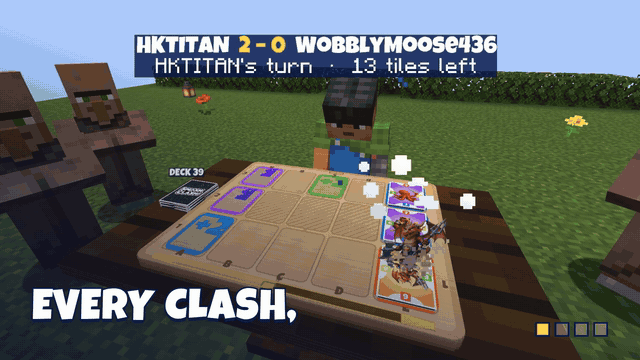
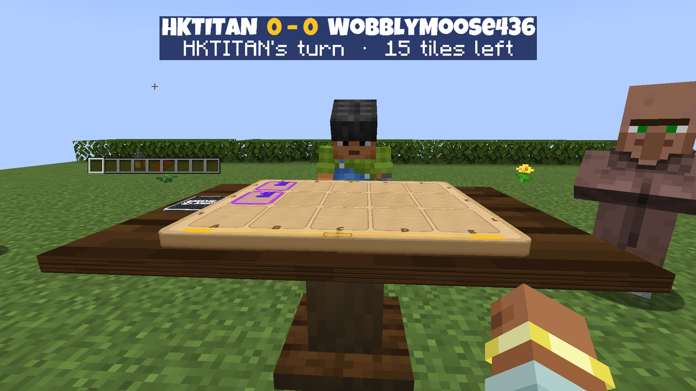
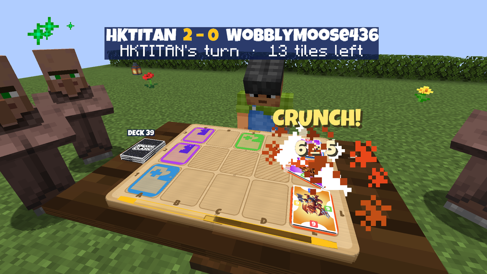
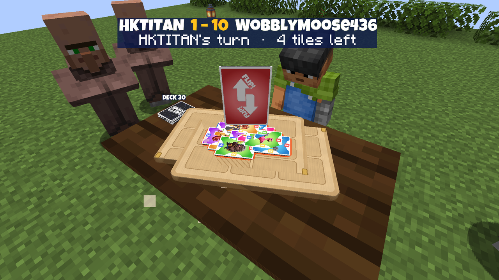
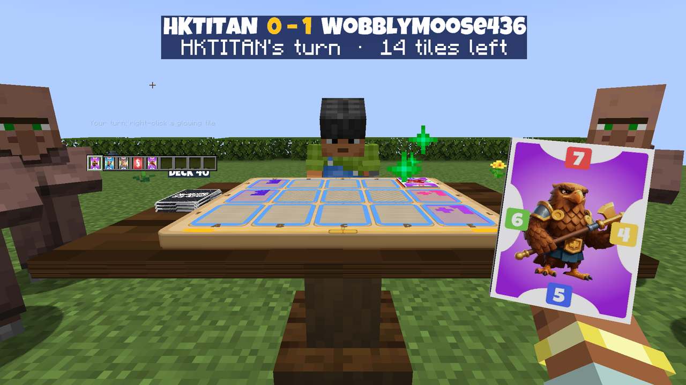
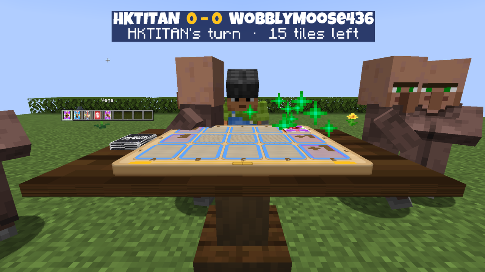
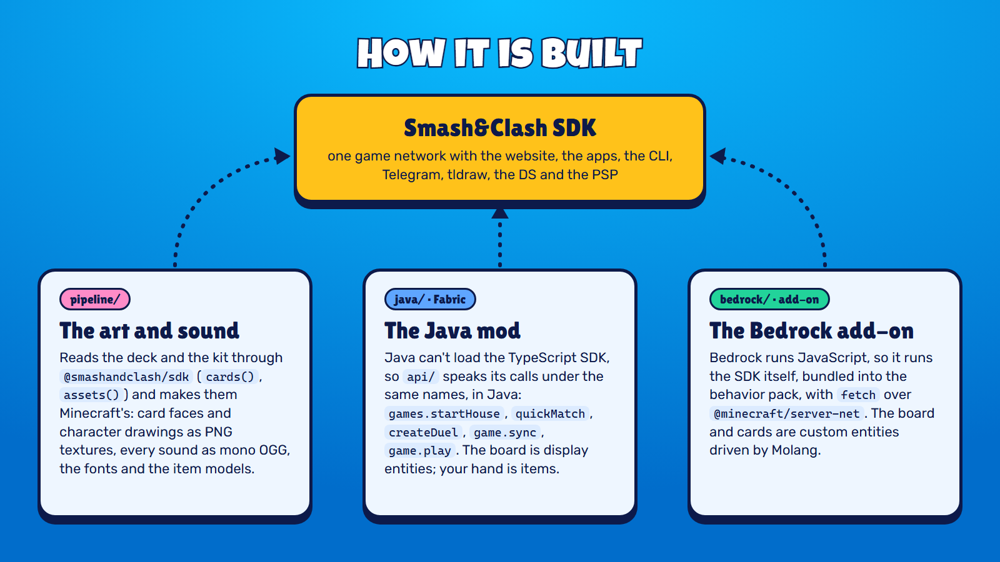

<p align="center">
  
</p>

<h1 align="center">Smash&Clash for Minecraft</h1>

<p align="center">
  The official Smash&Clash, inside Minecraft: place a table in your world, sit down at it, and play anyone - a friend at the same table, the house at your level, or anyone on any Smash&Clash client - on the board, in first person, with your hand in your inventory.<br>
  <b>Java Edition</b> (Fabric, 26.3) and <b>Bedrock Edition</b> (an add-on for Bedrock Dedicated Server 1.26.52), both built on the <a href="https://docs.smashandclash.in/sdk">Smash&Clash SDK</a>.
</p>

<p align="center">
  <a href="https://github.com/smashandclash/minecraft/releases/latest">Download</a> ·
  <a href="https://docs.smashandclash.in/clients">One game, every client</a> ·
  <a href="https://docs.smashandclash.in/sdk">SDK</a> ·
  <a href="https://www.smashandclash.in">smashandclash.in</a>
</p>

<p align="center">
  <b>Watch:</b>
  <a href="https://github.com/smashandclash/minecraft/releases/download/v1.0.0/smashandclash-minecraft-launch-16x9.mp4">the launch film (16:9)</a> ·
  <a href="https://github.com/smashandclash/minecraft/releases/download/v1.0.0/smashandclash-minecraft-launch-9x16.mp4">9:16</a> ·
  <a href="https://github.com/smashandclash/minecraft/releases/download/v1.0.0/smashandclash-minecraft-gameplay-1080p60.mp4">a whole recorded game (1080p60)</a>
</p>

---

## What you get

<p align="center"></p>

- **A table in your world.** Place it and the folding board lands and swings open on its hinge, like the website's. The board, the cards, the deck and the score sign are real things in the world: everyone nearby sees the game.
- **Your hand is in your inventory.** Hold a card and the tiles you can play it on glow - only you see them. Right-click one to play it. Other players see the back of the card you hold.
- **The website's animations, beat for beat.** The card's arc onto the tile, the clash (the lunge, or the rise and stomp), the reasons popping up between the cards ("5 ≥ 3", "4 < 5"), the defenders' recoil, the captures turning over with their hop and ring-down, the deal, the draws, and every effect: Boulder, Flip (the whole board turns), Freeze, Recruit, Swap. The timings, curves and heights come from the website's own scene code.
- **The characters fight.** When a card attacks, the character stands up out of its card and plays its own windup and strike drawings, on the kit's timing.
- **Sound.** The music while you play, every sound effect, the announcer, the how-to coach and all 46 characters' voice lines - from the table, so the people around it hear them.
- **Someone across the board.** Against the house or a player somewhere else, a figure in a player skin sits across from you with their name, holds a card on their turn and plays it.
- **A crowd.** Villagers who live nearby come over to watch from the sides, turn to whoever's turn it is, and cheer, hop and shake their heads at what happens on the board.
- **The whole game.** Mutators (the default) or Classic, ratings, How to play with the coach's voice, the Game Review and a replay link when it ends.

<p align="center">
  
  
</p>
<p align="center">
  
  
</p>

## Play anyone, on any client

Smash&Clash is [one game network with many clients](https://docs.smashandclash.in/clients). From a table you can:

| | |
| - | - |
| **PLAY** | the house opponent, at your level (its strength follows your rating) |
| **Quick match** | whoever is in the online queue - on the website, an app, the CLI, Telegram, tldraw, a DS... |
| **Open a room** | a six-letter code: anyone at this table takes the other seat, or anyone joins with the code from any client |
| **Join a code** | a room someone opened anywhere, by its code or a join link |

## Install

### Java Edition (Fabric)

1. Install [Fabric Loader](https://fabricmc.net/use/installer/) for Minecraft **26.3**.
2. Put [Fabric API](https://modrinth.com/mod/fabric-api) and `smashandclash-minecraft-<version>.jar` (from [Releases](https://github.com/smashandclash/minecraft/releases)) in your `mods` folder.
3. Start Minecraft with the Fabric profile. Get a **Smash&Clash Table** from the Functional Blocks tab, or craft one (3 paper, 3 birch slabs, a birch log), place it and right-click it.

It works in single-player and on LAN. On a server, install the mod on the server and on every player's game.

### Bedrock Edition (an add-on, on a dedicated server)

Bedrock lets an add-on reach the internet only on a [Bedrock Dedicated Server](https://www.minecraft.net/download/server/bedrock), and only with **Beta APIs** on (the game's HTTP module, `@minecraft/server-net`, is a beta module). Phones, tablets, consoles and Windows all join it.

1. Import `smashandclash.mcaddon` into a world (or copy `packs/RP` and `packs/BP` into the server's `resource_packs` and `behavior_packs`), and turn on **Beta APIs** in the world's experiments.
2. In the server's `config/default/permissions.json`, add `"@minecraft/server-net"` to `allowed_modules`.
3. In `server.properties`, set `texturepack-required=true` so everyone gets the art.
4. In the game: `/give @s smashandclash:table`, place it, use it.

## How it is built

<p align="center"></p>

- **`pipeline/`** - reads the deck and the kit through [`@smashandclash/sdk`](https://www.npmjs.com/package/@smashandclash/sdk) (`sc.cards()`, `sc.assets()`) and converts them for Minecraft: card faces, art and attack drawings as PNG block textures (the block atlas is mipmapped, so cards stay clean at a distance), every sound as OGG (mono, so it plays from the table), the fonts, the item models, and the board, drawn in code.
- **`java/`** - the Fabric mod. Minecraft Java runs Java, so the TypeScript SDK can't load there: `api/` speaks the SDK's calls under the same names, in Java (as the [DS and PSP clients](https://github.com/smashandclash/delta) do in C). The table holds the seats' player tokens on the server and plays them through the Smash&Clash SDK; the board is display entities, the hand is items, the glowing tiles are entities sent only to the player whose turn it is.
- **`bedrock/`** - the add-on. Bedrock runs JavaScript, so it runs the SDK itself, bundled into the behavior pack, with `fetch` over `@minecraft/server-net`. The board, the cards and the figures are custom entities whose properties drive their art and Molang animations; the menus are Bedrock forms.

Both send `minecraft` / `minecraft-bedrock` as their client name, so the other player sees where you play from.

## Build from source

```bash
# the art and sounds (needs Node 18+ and ffmpeg with libvorbis); already in the repo, so optional
cd pipeline && npm install && node build-assets.mjs

# Java: the mod (needs JDK 25)
cd java && ./gradlew build              # build/libs/smashandclash-minecraft-<version>.jar

# Bedrock: the packs and the .mcaddon (needs ffmpeg too)
cd bedrock && npm install && node tools/build.mjs     # packs/RP, packs/BP, dist/smashandclash.mcaddon
```

## Tests

- `cd java && ./gradlew runClientGameTest` - a real Minecraft client places a table, plays the house (screenshotting every clash and effect), plays a room-code game and a quick match against a second player on the network, and checks the table's footprint. Screenshots land in `build/run/clientGameTest/screenshots`.
- `./gradlew runClientGameTest -Pmedia` - films a real game frame by frame (the server's clock frozen and stepped one tick at a time, each tick drawn three times at 1920 x 1080: 60 fps with nothing dropped).
- On a Bedrock server: `/scriptevent smashandclash:ping` (can the table reach Smash&Clash) and `/scriptevent smashandclash:selftest` (a table plays a whole house game by itself, every animation running, and logs it).

## Credits and licence

The code is MIT. The Smash&Clash art, audio, characters, card data and name are Smash&Clash's: free to use in clients built for Smash&Clash, never to present as your own ([Using the art and audio](https://docs.smashandclash.in/build/overview#using-the-art-and-audio)). Fonts: Luckiest Guy (Apache 2.0), Lilita One (OFL 1.1).

NOT AN OFFICIAL MINECRAFT PRODUCT. NOT APPROVED BY OR ASSOCIATED WITH MOJANG OR MICROSOFT.
